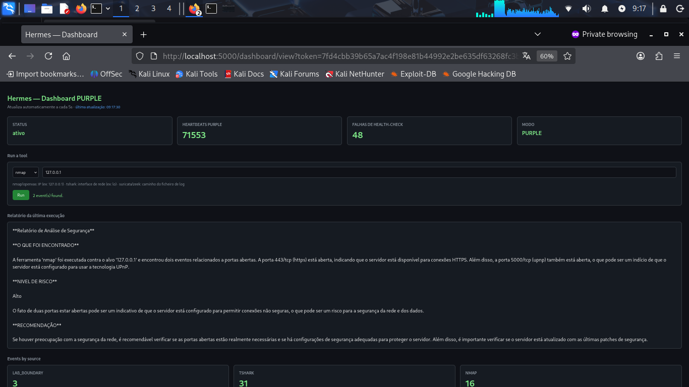
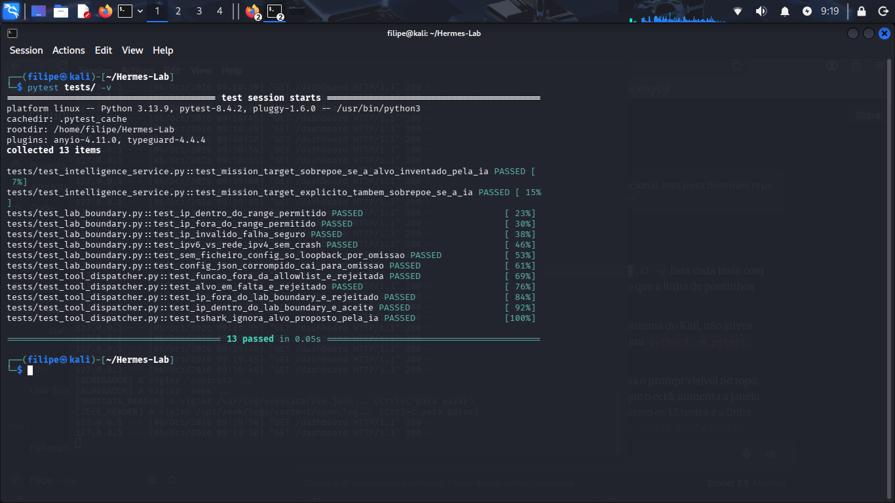

# Hermes-Lab

A personal cybersecurity lab platform, built as a learning project alongside a cybersecurity certification course (CET).

## What this project set out to be

The original goal was an autonomous security monitoring agent: Hermes would run continuously, use a local LLM to decide on its own which security tools to run and when, chain investigations based on what it found (e.g., notice an unusual open port and decide by itself to run a deeper vulnerability scan), and eventually accept instructions remotely via a webhook.

## What was actually built

Five real, individually working security tools, unified under one contract (`parse_evento` / `ler_uma_vez` / `vigiar`) and one event pipeline:

- **Nmap** — port scanning
- **OpenVAS/Greenbone** — vulnerability scanning
- **TShark** — packet capture
- **Suricata** — IDS/IPS, continuous background monitoring
- **Zeek** — network security monitoring, continuous background monitoring

All results flow through the same pipeline: raw output → `hermes/runtime/raw/` (audit trail) → normalized events → `hermes/runtime/clean/` → a local LLM (Ollama, `llama3.2:3b`) that writes a plain-language report for each execution, including a risk level and a recommendation.

Every tool call is gated by `hermes/core/lab_boundary.py`, an explicit allowlist of authorized IPs/networks (`config/lab_allowed.json`, `127.0.0.0/8` by default). This boundary exists to make sure no automated decision — human or AI — can ever act outside an authorized scope; the human operator is the one who decides what's in that allowlist.

## Screenshots

**Dashboard with a completed scan and AI-generated report:**



**Automated test suite:**



## What was tested, and what wasn't confirmed: autonomous decision-making

The core of the original vision — an AI that decides on its own and chains multiple tool calls to investigate a situation — was tested directly and empirically, not assumed.

**Single-step decisions worked well.** Asked a vague, generic question ("is there anything worth investigating?"), the model gravitated to the same tool almost every time (nmap, in 4-5 out of 5 trials — this held even after reordering the tool list, ruling out simple positional bias). But asked a specific, well-directed question ("check for known vulnerabilities on the target"), it chose the correct tool (openvas) in 5 out of 5 trials. The model reasons well when given a clear question.

**Multi-step chaining did not work.** In a direct test, the model was given the result of an nmap scan showing an unrecognized open port, and explicitly asked to investigate further if warranted. It did not call a second tool. It replied with a text summary instead — one that was internally inconsistent (it recommended "using Nmap" as a next step, despite Nmap being the tool it had just run) — and took 39.8 seconds, longer than the timeout used in production at the time.

This is a known, documented limitation of small (3B parameter), CPU-only local language models — not a flaw specific to this codebase. Larger models help with decision quality, but reliable multi-step, tool-chaining reasoning generally requires either much larger models or dedicated agent scaffolding, neither of which fit this project's hardware (an 8GB CPU-only desktop, chosen deliberately at the start to force scoping discipline).

## The decision

Rather than fake autonomy with hardcoded rules dictating when to escalate — which would have quietly replaced the model's judgment with the developer's, defeating the point of testing it — the project was scoped down to what was actually validated: **Hermes now operates in manual mode.** The operator selects a tool and a target from the dashboard; Hermes dispatches it, analyzes the results, and returns a plain-language report. No tool is ever chosen automatically, and no tool call is ever chained from another.

The autonomous decision loop that was built and tested is not deleted — it's preserved, working, and documented in `hermes/_archive/autonomia_experimental/`, in case a future version of this project (with a more capable model, local or cloud-hosted) makes it worth revisiting.

## Current architecture

Hermes is organized in layers, not run modes. There is a single way to run it: manual operation, started with `hermes_cli.py`. BLUE and PURPLE are names for parts of the code, not modes the user selects.

```
HERMES (hermes_cli.py → PurpleRunner)
   │
   ├── BLUE    — background detection: Suricata + Zeek, always running once started
   ├── PURPLE  — always-on service: HTTP API, token auth, rate limiting, dashboard
   ├── IA      — Ollama (local), used only to write per-execution reports, not to decide actions
   └── TOOLS   — shared capabilities, dispatched manually by the operator:
        ├── Nmap        (target: IP)
        ├── OpenVAS     (target: IP)
        ├── TShark      (target: network interface, e.g. "lo")
        ├── Suricata    (target: its own log file path)
        └── Zeek        (target: its own log file path)
```

Every tool shares the same contract (`parse_evento` / `ler_uma_vez` / `vigiar`), registered centrally in `hermes/tools/agregador_ferramentas.py`. Adding a new tool in the future only requires implementing this contract and adding it to the dropdown — no AI training or prompt tuning required, since nothing needs to "learn" to choose it.

## Running it

**Requirements:** Python 3.12 (tested), Firefox, and [Ollama](https://ollama.com) with the `llama3.2:3b` model pulled (`ollama pull llama3.2:3b`). The security tools are optional and are started on demand: nmap, tshark, Suricata, Zeek and OpenVAS/Greenbone. The automated tests need none of them.

```bash
git clone https://github.com/filipecastanheira-rgb/Hermes-Lab.git
cd Hermes-Lab
python3 -m venv .venv && source .venv/bin/activate
pip install -r requirements.txt
cp config/intelligence_config.example.json config/intelligence_config.json
python3 hermes_cli.py
```

This starts the PURPLE service (API, background monitoring, dashboard) and opens the dashboard in your default browser, already signed in: the CLI generates a single-use nonce and puts it in the URL fragment, which the page trades for an `HttpOnly` session cookie. Nothing to paste, nothing to store, and nothing in the URL that reaches the server. Tokens exist for clients that are not this machine — another host, a script — and are sent in the `X-Hermes-Token` header. Run the tests with `pytest tests/`.

**Why a private window:** Hermes opens the dashboard with `firefox --private-window`.
This is a functional requirement, not a security one. Requests from the dashboard to the
local API fail in a normal window on this system, and the visible symptom is the tool
buttons (nmap, Zeek, Suricata) answering `NetworkError`; in a private window extensions
are disabled and those requests go through. It is also not a token measure any more: the
token is no longer in the URL, and the page signs in with a single-use nonce.

So the private window stays as the default, with the reason written down. If Firefox is
not installed, Hermes falls back to the default browser and prints the URL - in that case
the tools may need the URL opened manually in a private window.

## Known limitations

- **Only Nmap and OpenVAS can target an arbitrary IP.** TShark listens on a local network interface (not an IP), and Suricata/Zeek read their own local log files — none of the three ever had the ability to target a remote address. This isn't a bug introduced by the manual-mode redesign; it reflects how these tools have always worked in this project.
- **`lab_boundary` defaults to `127.0.0.0/8` only.** Scanning any other network (e.g., a device on your local LAN) requires explicitly adding it to `config/lab_allowed.json` first — by design, this is a decision only the human operator makes, never automated.
- **Report quality reflects the local model's limits.** The small local LLM occasionally produces reports with internal inconsistencies (e.g., stating "no suspicious activity found" while also rating the risk level as "High"). Reports should be read as a helpful first pass, not a final verdict.
- **No autonomous or scheduled scanning.** Every execution is triggered manually. Background monitoring (Suricata/Zeek) is passive and continuous, but doesn't trigger any tool on its own.

## Archived / not part of the current program

Kept under `hermes/_archive/` for history. None of it is imported or run by the current program.

- `autonomia_experimental/` - the autonomous decision loop (see "The decision" above). `IntelligenceService.decide_action()` also remains in the active code, together with its tests, but is not connected to any execution path.
- `legado_pre_modo_manual/` - the former RED/BLUE/PURPLE run-mode system, the command-line router and the orchestrator, replaced by a single entry point (`hermes_cli.py`) once Hermes became manual. The RED mode was never implemented beyond an empty stub.
- `tcpdump/` - redundant with TShark, which covers the same capability and is fully integrated.

## Security scope

This project is meant to run exclusively against an authorized lab environment — by default, `127.0.0.0/8`. It has never been used, and is not intended to be used, against third-party networks or systems without explicit authorization.

## What's next

Two phases follow v1.0. The v1.0 release stays frozen at its tag. Work on the second slice happens in the `v2` branch and is closed with the tag `v2.0`; the reasoning behind the main choices is recorded in `docs/DECISIONS.md` on that branch.

### Cloud phase (in progress)

Run the same local model (llama3.2:3b) on an Oracle Cloud Always Free instance, reachable only through an encrypted WireGuard tunnel, to learn cloud deployment and compare it with the local setup. Planned: remote access for three invited users.

### GRC phase (planned)

A governance, risk and compliance (GRC) exercise, kept in a separate repository (Hermes-GRC). It is the last phase of the project, so that it covers the whole project at v2.0: the cloud instance and tunnel, the additional users and the local setup. ISO/IEC 42001 (AI management systems) is left for a later phase.
